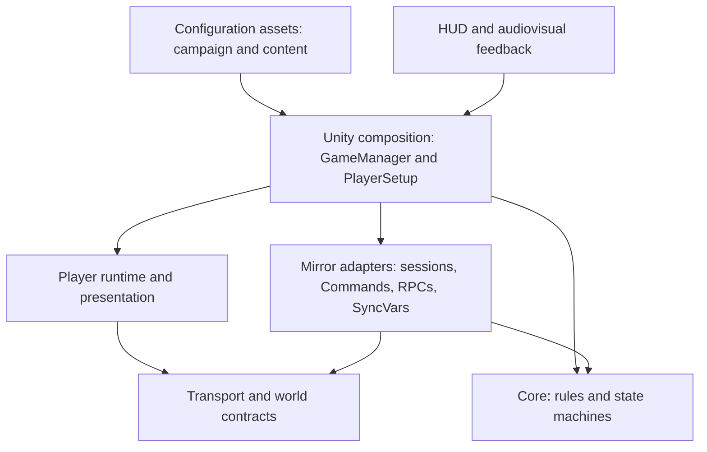
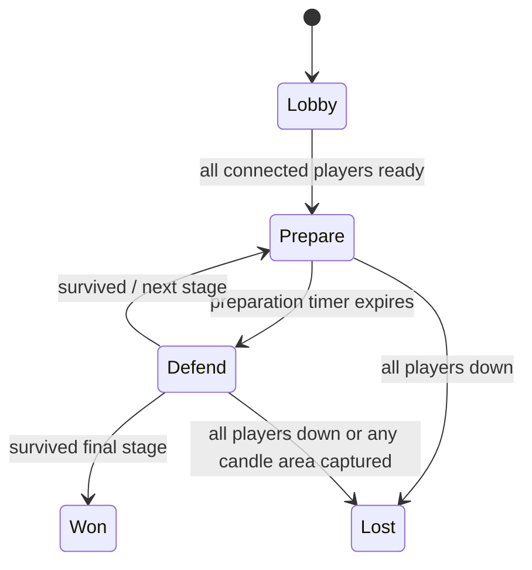

# Architecture and onboarding

The Nightmare is a cooperative FPS on **Unity 6000.6.7f1**, URP and Mirror/KCP.
The architecture uses plain C#, MonoBehaviours, ScriptableObjects and explicit initialization;
there is no DI container. [BUILDING.md](BUILDING.md) covers running/building/testing;
[REFACTORING.md](REFACTORING.md) records migration decisions and verification;
[CODE-QUALITY.md](CODE-QUALITY.md) describes method boundaries and XML documentation conventions;
[NETWORKING.md](NETWORKING.md) records LAN and future online-service decisions.

## Bird's-eye view

Core computes decisions without Unity or networking. Unity components apply movement, animation,
audio and scene changes. Mirror adapters carry requests and replicated state. Composition wires
these parts together. This is an incremental modular architecture: existing scene-level scripts
still live in Assembly-CSharp, and replacing Mirror will require new adapters and composition,
not merely changing one setting.

## Scenes and lifecycle

| Build scene | Responsibility |
|---|---|
| `MainMenu` | Title, settings, trailer and navigation. |
| `LobbyTests` | Host/join UI and persistent network manager. |
| `ExtremeHomeMakeover` | Authored house, rooms, grid, capture areas and match composition. |

Open MainMenu to run normally. Old experimental scenes are outside the supported campaign.
`CustomNetworkManager` owns session lifetime and installs `SessionServices.Current` for menu
components. GameManager composes a fresh MatchSession, MatchWorldRegistry, EnemyWaveSpawner and
MatchPlayerCoordinator for each loaded game. Their state is instance-owned and is discarded on unload. PlayerSetup initializes authority, options, input,
equipment and HUD bindings. Remote copies disable local input/cameras. Teardown detaches billboard
cameras and persistent consumers from the match before the scene is unloaded.

## Assemblies and dependency rules

| Assembly / location under `Assets/Scripts` | Responsibility and dependencies |
|---|---|
| `Nightmare.Core` / `Core` | Engine-free C#: ammo, weapon operations, enemy decisions, match progression, capture rules, identifiers and service ports. `noEngineReferences` is enforced. |
| `Nightmare.Contracts` / `Contracts` | Unity-shaped ports for combat/equipment/placement requests, hit targets, enemy perception/traps, lifetime and match transport. Depends on Core. |
| `Nightmare.Configuration` / `Configuration` | ScriptableObject content definitions. Depends on Core and Unity. |
| `Nightmare.Runtime` / `Runtime` | PlayerController, PlayerMotor, WeaponPresentation, Weapon, authority and rig bindings. Depends on the preceding assemblies, never Mirror or Assembly-CSharp. |
| `Assembly-CSharp` | Composition, remaining world/UI components, player interactions and Mirror adapters. Networking implementation is grouped under `Networking/Mirror`. |
| Editor assembly / `Editor` | Builds, asset migration/validation and saved network identities. |
| `Nightmare.Tests.*` / `Assets/Tests` | Core tests and characterization/integration fixtures. Support reflection bridges Assembly-CSharp without a runtime dependency on test code. |

`Tools/check_module_boundaries.py` checks asmdef cycles, the engine-free Core and Mirror import
boundaries. Assembly-CSharp's world/composition dependencies are still real; the checker does not
claim full isolation of every legacy component. Preserve script `.meta` GUIDs when moving files.
All peers must use the same rebuilt game version: adding/moving network behaviours is not a
backward-compatible wire migration for older players.

## Match flow and scene composition

`MatchProgress` contains `MatchPhase` and a zero-based `StageIndex`:

CampaignDefinition lists StageDefinitions. Each stage defines preparation/defense duration and
weighted enemy prefabs. StageBinding pairs it with a Room, chest and optional entry door in the
scene. Room owns explicit grid/capture/spawn/render roots. MatchSceneBindings holds HUD/camera
references; MatchHudPresenter observes progress and owns instruction coroutines, music and results.

The shipped order remains room roots **1, 2, 0**, preparation **60/60/90 seconds**, defense
**120/180/300 seconds**, Ghost weight **20%**. The production progression uses stage count, so a
fourth stage needs no new enum case. The old room-specific enum, its translation map, static registries and ClockManager accessors
have been removed. All callers use MatchProgress and the instance clock. Experimental scenes
without explicit campaign configuration are retained as archives; their match startup is disabled
with a diagnostic instead of reconstructing an implicit three-room campaign.

The server advances phases. Loss evaluation occurs in LateUpdate before timer-driven advancement:
a captured area at the final timer boundary cannot become a win. PhaseClock owns time; the HUD
only formats it. ReadyRoster deduplicates player IDs and withdraws disconnected players.
MirrorMatch carries phase/index, ready count and campaign-start notifications to peers.

## Match ownership and dependency wiring

| Owner | Responsibility |
|---|---|
| GameManager | Composition and ordered transitions across modules; no world/player registries or spawn coroutine. |
| MatchSession (Core) | Progress, PhaseClock, readiness and one pure result decision. Loss precedes expired-defense advancement. |
| MatchWorldRegistry | Authored room/capture/grid indices, active-stage context and transport-neutral IStageEnemy registry. |
| EnemyWaveSpawner | Spawn wait, no-repeat point selection, configured enemy weights and marker/coroutine lifecycle. |
| MatchPlayerCoordinator | Player membership, active/downed membership, colors, control mode and campaign entry setup. |
| MatchHudPresenter | Instructions, arrow, music and result presentation; observes committed progress. |

GameManager initializes scene participants through IMatchParticipant. Its Start also binds persistent
presentation components created by runtime bootstraps. MirrorMatchBinding injects spawned hierarchies
at Mirror server/client callbacks, using the backend's explicitly registered scene context. The
backend stores a Game reference supplied through IMatchSceneRegistration; gameplay components do
not locate GameManager through a static Instance or query the scene each frame. Hierarchy discovery
is restricted to composition/spawn boundaries. This is explicit initialization, without a DI container.

The match session initializes Lobby independently of player presentation. Repeated campaign-entry
notifications do not reset phase, time or loadout.

The match root retains serialized campaign, content, stage bindings, scene bindings, spawn settings,
billboard references and disabled-floor references. Existing GUIDs and authored references remain;
only obsolete fallback arrays are removed. Presentation flags still reset between sessions, but the
player/enemy/world collections themselves are no longer static.

Successful defense ordering is: stop the spawn coroutine, retire the surviving enemy snapshot,
apply the next progress value and activate its room/clock, then notify presentation and replicas.
Retirement disables combat and colliders synchronously on authority and replicates the existing
per-prefab dissolve. It skips combat death animation/voice; enemies already dying finish normally.
Only authority performs final despawn through IEntityLifetime. The same cleanup runs at final victory.
CaptureArea may drain only during Defend when registered in the current stage. It never independently
changes match progress. Completed/future/preparation areas cannot drain or end a later room.

## Players, weapons and damage

PlayerController reads desktop input or an injected analog provider. PlayerAuthority supplies
ownership, input permission, match state and preferences. PlayerMotor moves the Rigidbody during
FixedUpdate and applies camera view during rendering; interpolation and existing recoil/ADS/sway
remain. PlayerRigBindings references model animators, remote hand, weapon holder and mode roots,
so Boy/Girl do not need identical bone hierarchies. See [PLAYER-FEEL.md](PLAYER-FEEL.md).

PlayerShoot handles local firing/animation and calls IPlayerCombatRequests. MirrorPlayerCombat
validates incoming damage and routes server damage and cosmetic feedback. PlayerEquipment handles
pickup/local loadout; MirrorPlayerEquipment handles replicated held weapons, revive and chair
requests. There are still two carried weapon slots; adding weapon definitions does not alter that
rule. WeaponDefinition holds authored stats, permitted modes and first/third-person poses.

AmmoState defines **Total = loaded magazine + reserve**. A rifle starts at **31/155**, not
31 plus 155 reserve. FullReserveMagazines is `Reserve / Capacity` with integer division, preserving
the HUD icons. Firing consumes one round before effects. WeaponOperation owns one completion timer;
a reload is bound to its captured weapon, cancelled on death/disable/switch teardown, and never
refills whichever gun happens to be active later. Same-weapon pickups refill total ammunition
without refilling loaded rounds. The pistol starts single and retains its authored B-key mode cycle.

| State/action | Authority |
|---|---|
| Input, movement, magazine/reserve, local inventory, first-person presentation | Owning player; movement replicated through the existing Mirror transform. |
| Health, friendly fire, revive, explosions, enemy AI and match results | Server. |
| Hit ray and requested damage | Reported by owner; server checks target/life/damage bounds. No authoritative ray reconstruction or lag compensation. |
| Grid reservation, range/cell validation, spawning and rejection | Server; owning inventory decremented on acceptance. |
| Animation, hit flashes, sound, overlay | Presentation driven by confirmed state/events. |

This preserves the current trusted LAN model. It is not an anti-cheat redesign: ammo/inventory
are not server-ledgered, and public Internet play needs additional validation. Lobby/results disable
player damage. [FRIENDLY-FIRE-EXPLOSIONS.md](FRIENDLY-FIRE-EXPLOSIONS.md) describes explosions.

## Enemies, navigation and traps

EnemyBrain owns Walking/Screaming/Running/Fighting/Blocked/InZone decisions and calls IEnemyWorld.
EnemyControllerServer applies NavMesh paths, destination selection, melee contact and damage;
EnemyControllerClient follows replicated transforms and presents effects. Non-authoritative peers
do not simultaneously navigate a network-driven enemy. EnemyDefinition supplies health, speeds,
damage, death delay and brick susceptibility; prefabs retain their own rigs, feedback/audio and
collider setup.

Melee can start from Walking or Running. Screaming and Blocked retain their grace periods. Contact
is tracked with colliders and checked against the attack volume, preventing stale contact from
continuing damage. The server stops navigation during a valid melee fight and resumes pursuit when
contact is gone. Initial capture targets favor the spawn's nearest candle area; later retargeting
uses the nearest eligible area. Ghosts remain unaffected by bricks and do not consume charges.
CaptureRules preserves candle drain by enemy count. Losing **one area** loses the room.

EnemyFeedback synchronizes confirmed hit/attack/death effects. DissolveEnemyBody presents the
material dissolve and asks IEntityLifetime to despawn only on authority. See
[ENEMY-FEEDBACK.md](ENEMY-FEEDBACK.md) and [GHOST-AND-COMBAT-POLISH.md](GHOST-AND-COMBAT-POLISH.md).

## Placement and content extension

GridPoint/CaptureArea have persistent authored IDs; requests do not use culture-formatted vectors.
GridCellId is a separate rounded world-coordinate lookup key for finding the hovered cell.
MirrorPlacement checks ID, occupancy, position and the existing two-tile range; IPlacedItem attaches
the stable ID to the spawned item. An acceptance acknowledgement spends inventory. Rejection keeps
inventory and triggers existing red/audio feedback. Trap consumption releases that same ID directly on the server before destruction, then notifies
clients. Server occupancy never depends on receiving its own cosmetic RPC.

ContentCatalog lists weapons/placeables. PlaceableDefinition contains prefab, preview and capacity;
PlaceableGrant pairs a definition with a chest amount. Shipped chests use authored grant arrays;
old fields remain solely to preserve unmigrated experimental scenes. Unlimited chest recollection
is intentional existing behavior; the same-frame guard prevents duplicate calls.

To extend content:

1. **Stage:** create a StageDefinition, append it to Campaign, author Room roots and StageBinding,
   assign chest/door, bake NavMesh and assign stable IDs. Validate durations and spawn routes.
2. **Weapon:** create WeaponDefinition and matching prefab, append to catalog with matching
   LegacyIndex, assign pickup WeaponId and register the networked prefab where required.
3. **Enemy:** create EnemyDefinition and prefab with the established root NetworkIdentity,
   navigation/colliders/feedback and adapters. Register it in NetworkManager and stage weights.
4. **Placeable:** create definition, preview and prefab implementing IPlacedItem as needed; append
   catalog entry, chest grants, network registration and matching HUD count reference.

Run **The Nightmare → Validation → Assign stable scene IDs**, save the scene, then
**Validate game content**. Never regenerate valid IDs during ordinary loading or builds.

## Future backends and remaining compatibility

ISessionService/ISessionDirectory hide host/join/list/leave from lobby UI. IMatchTransport and player
request ports separate local gameplay calls from Mirror Commands. A future backend provides new
adapters and explicit bootstrap wiring. Relay can be added through a suitable transport/service
adapter while keeping Mirror gameplay. Solo can provide local adapters/authority and the same rules;
neither feature is implemented by this refactor.

Compatibility registries, lower-case UnityEvent methods and several original serialized names are
retained. Some old world/effect components still use fixed child indices with fallbacks, and
composition still coordinates concrete Unity adapters. These are documented boundaries, not reasons
to introduce a service locator throughout gameplay. SessionServices is restricted to session/UI
composition. Mobile performance, device controls and adverse real-network conditions need their own
validation; desktop tests cannot prove them.

Rendering/settings are documented in [URP.md](URP.md), [GRAPHICS_SETTINGS.md](GRAPHICS_SETTINGS.md)
and [URP-FINALIZATION.md](URP-FINALIZATION.md). Third-party Mirror, uGUI/TMP, QuickOutline and effects
remain vendored/package-owned; this refactor does not rewrite them.

## Ghost visual-motion boundary

GhostLevitation is a transport-free Runtime component on a visual pivot outside the Animator.
EnemyFeedback is the Mirror presentation adapter: it supplies shared time/netId to Present and
freezes the pivot for death/retirement. The component never advances enemy decisions or changes
navigation state. This keeps cosmetic motion separate from the existing enemy brain while retaining
the bone-attached head hitbox's alignment with the model. Parameters and verification are recorded
in GHOST-AND-COMBAT-POLISH.md.
